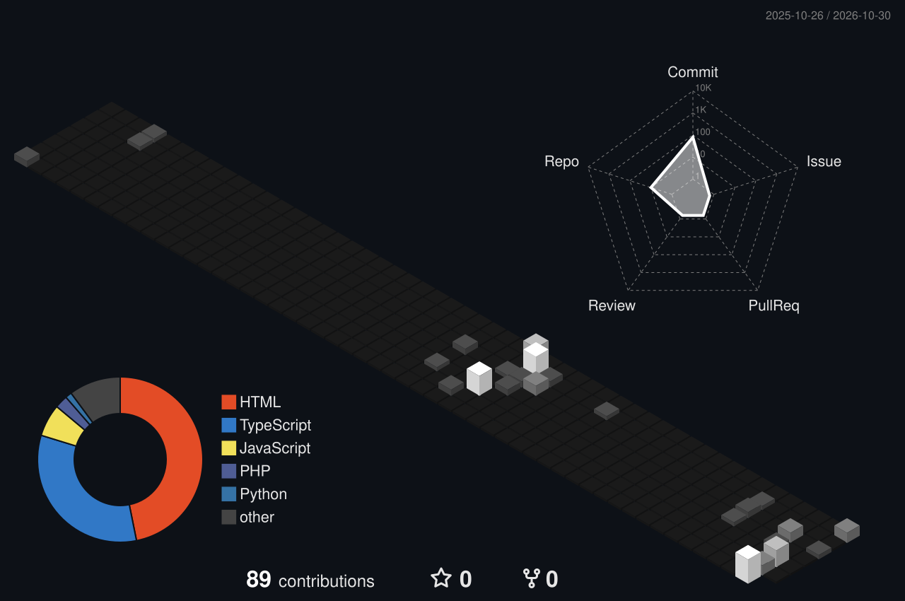

<!-- Header banner (white → grey, animated fade-in) -->

  

<!-- Typing animation -->

  

  

---

## 👋 About Me

Saya **Nehemia**, seorang **Creative Technologist**. Fokus utama saya ada di **Front-End Development**, yaitu menggabungkan presisi teknis dengan kreativitas visual untuk membangun antarmuka digital yang terasa "hidup".

- 🎨 Frontend Developer & UI/UX Designer
- 🌱 Proyek yang pernah saya kerjakan: sistem monitoring **Agrosense AIoT**, aplikasi fitness interaktif, dan prediksi penyakit jantung berbasis ML
- 🤖 *"Leveraging AI as a professional tool, not a replacement."*

---

## 🛠️ Tech Stack

  

---

## 🚀 Featured Projects

| Project | Deskripsi | Link |
|---|---|---|
| 🫀 **Heart Disease Prediction** | Clinical Decision Support System pakai **XGBoost** yang menganalisis 13 parameter medis untuk memprediksi risiko penyakit jantung secara real-time. | [Live Demo](https://heart-disease-prediction-900.streamlit.app/) |
| 💡 **PromptLip** | Prototype platform untuk menyimpan, menguji, dan berbagi prompt AI dengan antarmuka yang modern. | [Figma Prototype](https://www.figma.com/proto/6R8b8NP2L0x9yYoX6eEHtM/Prototype-PromptLip?node-id=1-2&starting-point-node-id=1%3A2) |
| 🏥 **Healthcare Website Design** | Desain website layanan kesehatan dengan fitur booking dokter, rekam medis digital, dan health tracking. | [Figma Prototype](https://www.figma.com/proto/UYqtGkdjEBWOYsEzt4jQIy/Desain-web-healthcare?node-id=1-4&starting-point-node-id=1%3A4) |

> 📂 Proyek lainnya ada di [portfolio saya](https://portofolio-nehemia.vercel.app/).

---

## 🧊 3D Contribution

<!-- Dibuat otomatis oleh workflow .github/workflows/profile-3d.yml -->

  

---

## 📊 GitHub Stats

  
  

  

---

<!-- Snake animation, dibuat otomatis oleh workflow .github/workflows/snake.yml -->

  

<!-- Footer -->

  

